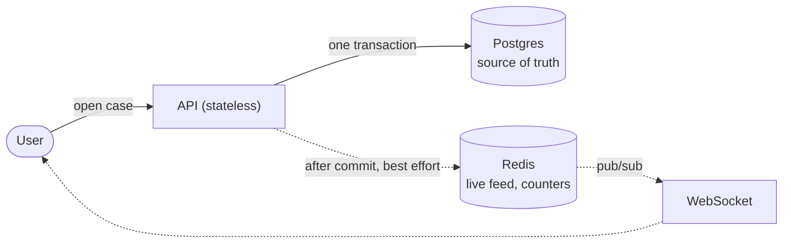
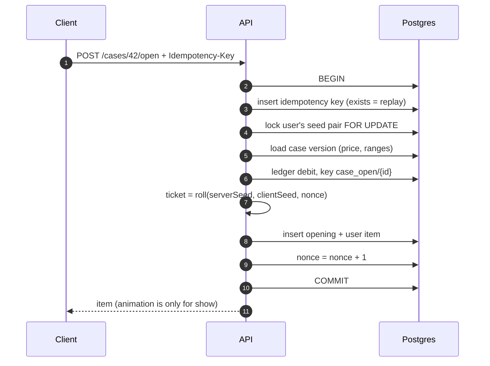
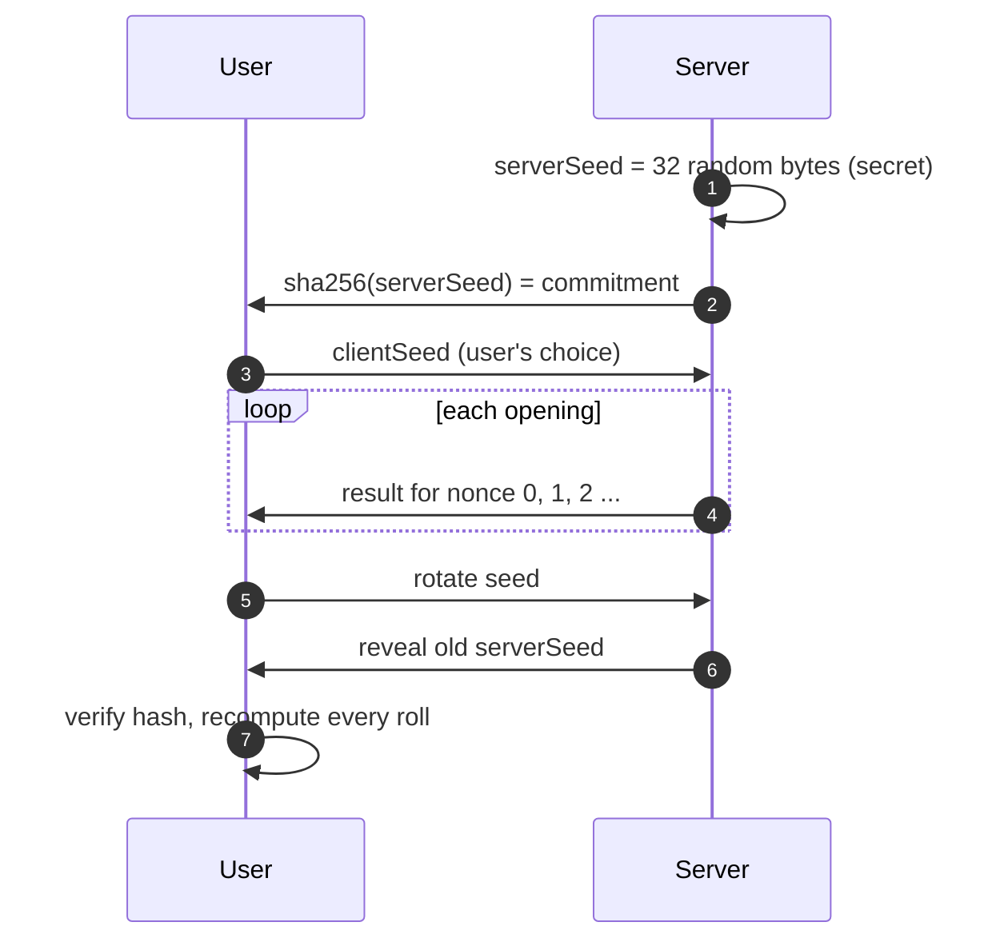
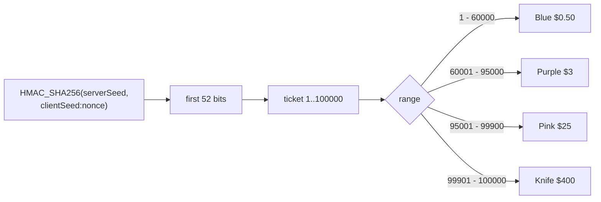

# Case opening + Provably Fair: how I would build it

**Goal:** charge exactly once, and nobody can influence the result, including us.

---

## 1. Where it runs

- **Postgres is the source of truth.** Redis can lose an event without losing money.
- **Money is a ledger** in integer cents: every movement is a posting with a unique key.

---

## 2. The request: one transaction

---

## 3. Provably Fair

---

## 4. Data model (minimal)

| Table | Key columns | Constraints / notes |
|---|---|---|
| `seed_pairs` | `id`, `user_id`, `server_seed_enc`, `server_seed_hash`, `client_seed`, `nonce`, `status (active\|revealed)`, `revealed_at` | **Partial unique** `(user_id) WHERE status = 'active'`. The server seed is encrypted at rest. |
| `cases` / `case_versions` | `case_versions`: `id`, `case_id`, `price_cents`, `total_tickets`, `house_edge_bps`, `published_at` | A version is **immutable**. Changing odds or price = a new version. |
| `case_version_items` | `case_version_id`, `skin_id`, `ticket_from`, `ticket_to`, `value_cents_at_publish` | Ranges cover `1..total_tickets` with no gaps and no overlap (checked on publish). |
| `case_openings` | `id`, `user_id`, `case_version_id`, `seed_pair_id`, `nonce`, `client_seed`, `ticket`, `skin_id`, `price_cents`, `created_at` | **Unique** `(seed_pair_id, nonce)`: a nonce can never be used twice. Partitioned by month. |
| `user_items` | `id`, `user_id`, `skin_id`, `status`, `source_type`, `source_id`, `value_cents_at_acquire` | A site-inventory item is a **claim** on a skin, not a real Steam item yet. |
| ledger: `ledger_postings`, `ledger_entries`, `account_balances` | posting `key`, e.g. `case_open/{openingId}` | Posting key **unique**. Integer cents. User balance `CHECK (>= 0)`. |
| `idempotency_keys` | `user_id`, `key`, `response_status`, `response_body` | **Unique** `(user_id, key)`. |

### Key constraints

| Constraint | Why |
|---|---|
| One `active` seed pair per user | One nonce stream per user |
| `unique (seed_pair_id, nonce)` | A nonce can never be used twice |
| Immutable case versions | Every opening references the odds it used |
| `unique (key)` on postings | One opening = at most one debit |
| `CHECK (balance >= 0)` | The DB itself refuses overspending |

---

## 5. What can go wrong

| Risk | Example | Protection |
|---|---|---|
| **Charged twice** | Double click, mobile retry after a timeout | Idempotency key replays the first response, and the posting key is unique |
| **Parallel overspend** | 5 tabs open cases at once with a $10 balance | Seed-pair `FOR UPDATE` = per-user mutex, plus `CHECK balance >= 0` |
| **Re-roll** | Retry until a good result | Deterministic roll, and **the nonce advances only on commit**: a retry gives the same result |
| **Predictable rolls** | Weak randomness, a leaked seed | `crypto.randomBytes`, seed encrypted at rest, never logged, rotate on suspicion |
| **Odds changed silently** | Shrink the knife's range | Immutable public case versions. **PF proves the roll, not the odds.** |
| **House edge drift** | A skin in the case doubles in price | EV monitor + alert, fix = publish a new version |

